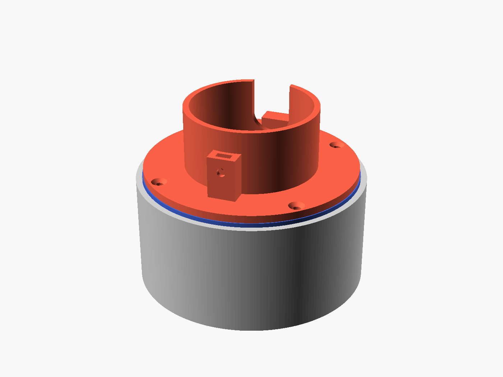
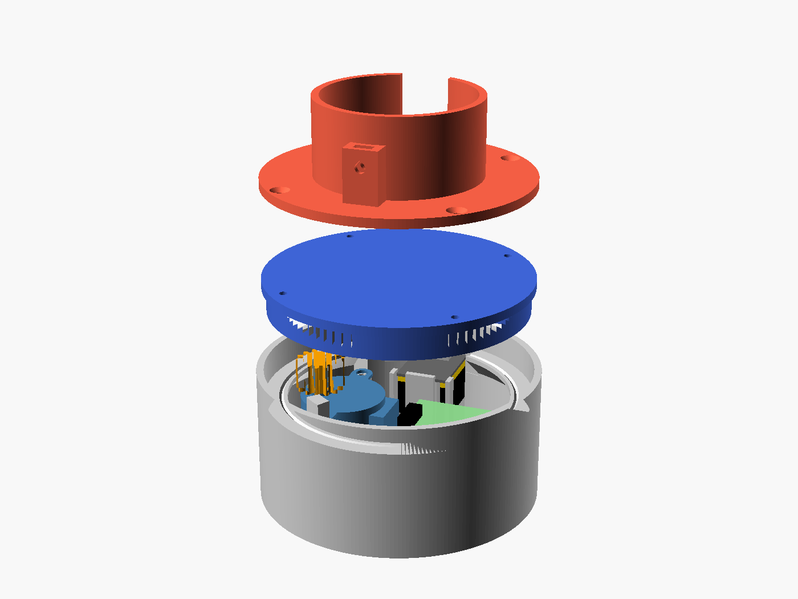
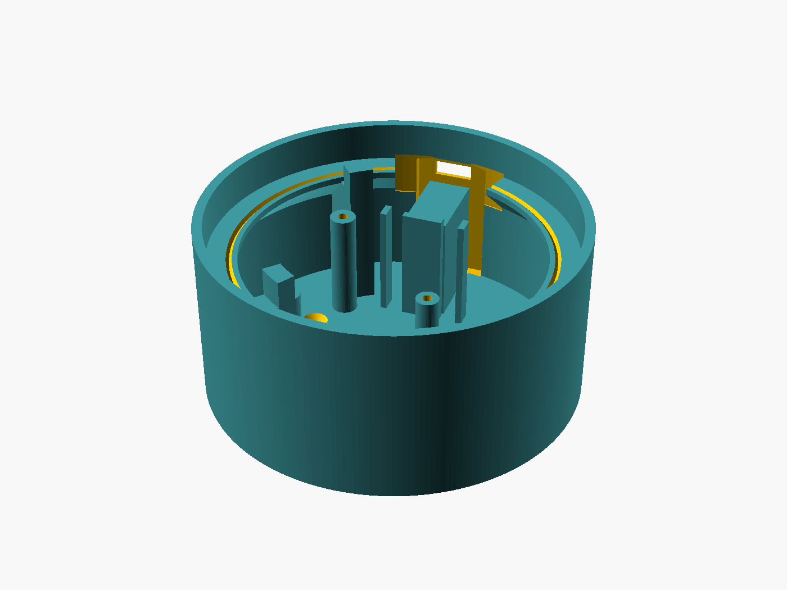
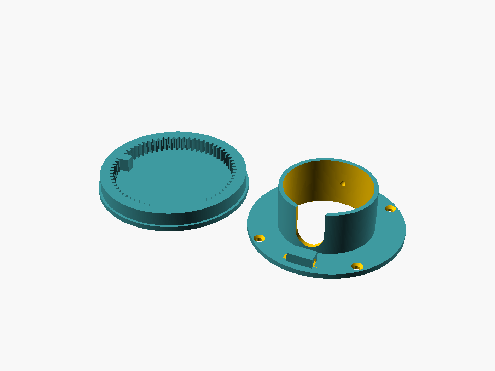
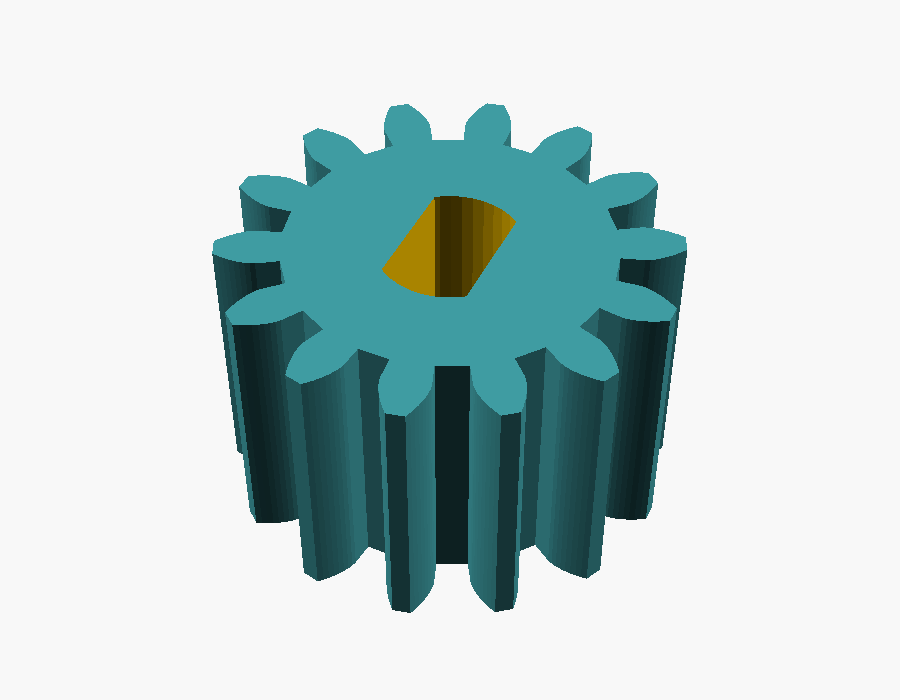

# G3 Flex pan turntable

A 3D-printable motorized pan base for the UniFi G3 Flex camera. It turns the camera ±110° under Home Assistant control. Inside are a cheap 28BYJ-48 stepper motor, a printed 5:1 internal gear and an ESP32-S3 running ESPHome.

- **Cheap parts:** one motor with its driver board, one small ESP32, a few screws. No bearings.
- **Prints without supports** in PETG.
- **Hard stops at ±115°** keep the camera cable from winding up. They also give the firmware a reference point, so it finds its zero position by itself at every boot.
- **Home Assistant integration:** set an angle, nudge left and right from the camera card, and turn the camera away automatically when privacy mode is on.

The model is fully parametric OpenSCAD (`g3flex_pan_turntable.scad`), so you can adapt it to other cameras or boards.

## How it works

The turntable has three printed parts, shown from the bottom up:

1. **Base housing (grey):** holds the motor, the ULN2003 driver board and the ESP32. A ring-shaped ledge inside the wall carries the rotor.
2. **Rotor (blue):** a lid with a 70-tooth internal gear on its underside. It rests on the ledge and slides on it.
3. **Cup adapter (orange):** screwed onto the rotor. The G3 Flex's round body sits in it, held by a set screw.

A 14-tooth pinion on the motor shaft drives the internal gear (5:1). A small tab on the rotor (the *stop lug*) hits one of two posts in the base at ±115°.

## Bill of materials

**Electronics**

| Qty | Part | Notes |
|---|---|---|
| 1 | 28BYJ-48 5 V stepper motor + ULN2003 driver board | Usually sold as a pair |
| 1 | ESP32-S3 SuperMini | Solder the pin headers so they point **down** (away from the USB-C side) |
| 6 | Female-female dupont jumper wires, ~10 cm | 4 signal + 5 V + GND |
| 1 | USB-C power supply, 5 V / 1 A or more | Powers the ESP and the motor |

**Screws**

| Qty | Part | Used for |
|---|---|---|
| 2 | M3×8 self-tapping | Motor mounting ears → base |
| 4 | M3×6 self-tapping (or M2.5) | ULN2003 board → base |
| 4 | M3×8 countersunk | Cup adapter → rotor |
| 1 | M3×10 grub screw (or M3×12 thumb screw) + 1 M3 nut | Set screw that clamps the camera. The nut slides into the slot in the boss on the side of the cup. |
| 3 | 3.5×16–20 mm countersunk wood screws | Optional: screw the base to a shelf |

**Optional:** a dab of PTFE or silicone grease for the sliding ledge.

## Printing

| STL | Orientation | Contents |
|---|---|---|
| `stl/base_housing.stl` | floor down | Housing, sliding ledge, motor and PCB mounts, hard-stop posts |
| `stl/rotating_cup.stl` | as plated | Rotor (deck down) + cup adapter (flange down). Both on one plate. |
| `stl/pinion_14t_m1.stl` | flat, either side | 14-tooth module-1 pinion for the 28BYJ-48's 5 mm double-flat shaft. Print it unless you already have a 14T m1 pinion. |
| `stl/platform_adapter.stl` | optional | Flat Ø86 mm platform (4× M3 on Ø78 mm) instead of the camera cup, for other payloads |

PETG, 0.4 mm nozzle, 0.2 mm layers, 3–4 perimeters, 20–30 % infill, no supports. Every overhang is 45° or steeper. The only bridge is a 9.5 mm span over the USB-C opening.

| Base housing | Rotor + cup adapter | Pinion |
|---|---|---|
|  |  |  |

## Wiring

| ESP32-S3 SuperMini | ULN2003 board |
|---|---|
| GPIO1 | IN1 |
| GPIO2 | IN2 |
| GPIO3 | IN3 |
| GPIO4 | IN4 |
| 5V | + (5–12 V) |
| GND | − |

The motor plugs into the ULN2003's white 5-pin socket. Power the whole thing through the ESP32's USB-C port.

## Assembly

1. **Optional: mount the base.** Screw it to the shelf first. The countersunk heads end flush, so the motor and boards can sit over them.
2. **ESP32.** Plug the dupont wires onto its headers first. Slide its USB-C end into the pocket in the rear wall, then press the other end down until the clip snaps over the board. Route the wires inward under the board, next to the clip.
3. **ULN2003.** Screw it onto its four standoffs, with the input header (IN1–IN4) on the edge facing the centre. Connect the wires as in the wiring table.
4. **Motor.** Push the pinion onto the shaft. Screw the motor to its two mounting posts with the pinion up, and make sure both mounting ears lie flat before tightening. Coil the spare motor cable and tie it down low, below the ledge, so the rotor's stop lug can't catch it.
5. **Optional: grease.** Put a thin film of grease in the ledge groove.
6. **Rotor.** Turn it so the stop lug points away from the motor, then drop it into the base. Gravity holds it down, and the rim of the base keeps it centred.
7. **Cup and camera.** Screw the cup adapter onto the rotor with its slot (for the camera cable) at the rear. Insert the camera, then tighten the set screw.

## Firmware (ESPHome)

[`firmware/camplatform.yaml`](firmware/camplatform.yaml) is a complete ESPHome config.

1. In ESPHome (for example the ESPHome Device Builder app in Home Assistant), add these to **Secrets**: `wifi_ssid`, `wifi_password` and `camplatform_api_key`. For the key, use a random base64 string such as the output of `openssl rand -base64 32`.
2. Create a new device, paste in the YAML, and install it. The first install goes over USB; later updates go over Wi-Fi. The config uses the generic `esp32-s3-devkitc-1` board definition, which works for the SuperMini.
3. If the board can't join your Wi-Fi, it opens an access point called **Camplatform Fallback**, where you can enter the Wi-Fi details.

What the firmware gives Home Assistant:
- **G3 Flex Pan Angle**, a number from −110° to +110°. Positive angles turn the camera to the right, as seen from behind the camera.
- **Home Pan**, a button that re-finds the zero position.

**Homing.** The motor has no position sensor. At every boot the firmware drives slowly into the −115° stop. The motor simply skips steps there, which is harmless. It then sets that point as −115° and returns to the last angle. It remembers where the rotor last stopped, so normally it only stalls against the stop for about 1 s. After a power cut during a move, or when you press **Home Pan**, it sweeps the full range instead.

The motor's real gear ratio is about 63.68:1. Combined with the 5:1 ring gear that's about 10189 steps per turn of the turntable, or 28.3 steps per degree. Expect about 0.7° of play from gear backlash.

## Home Assistant

The firmware only moves the motor. Home Assistant decides where the camera points. The `home-assistant/` folder has the example config from the original install. Each file lists at the top the entity IDs you need to change.

| File | What it does |
|---|---|
| [`script_cat_cam_pan.yaml`](home-assistant/script_cat_cam_pan.yaml) | Script `cat_cam_pan`. `left` / `right` move 15°, `default` goes to +30°. Create it under *Settings → Automations & scenes → Scripts → Edit in YAML*. |
| [`automation_privacy_mode.yaml`](home-assistant/automation_privacy_mode.yaml) | Privacy mode on (the switch from the UniFi Protect integration): turn to −110°. Off: go back to the default +30°. |
| [`dashboard_cat_cam_card.yaml`](home-assistant/dashboard_cat_cam_card.yaml) | Camera card with left / right / home buttons over the live view. Needs the [WebRTC Camera](https://github.com/AlexxIT/WebRTC) custom card (install via HACS). |

## Customizing the model

Open `g3flex_pan_turntable.scad` in OpenSCAD and choose what to show or export with the `part` setting in the Customizer. `assembly` shows everything, and the plate names produce the STLs. The `check_*` parts are views for checking collisions.

Useful parameters:
- `camera_dia` and the other *Camera cup* settings fit a different camera.
- `sweep_angle` sets the travel between the hard stops (default 230°).
- `dupont_len`, `dupont_wire_bend` and `esp_row_x` describe your plugs and ESP32 board. Measure yours and re-export if they differ.
- `usb_recess` sets how far the USB-C socket sits behind the outer wall.

Dimensions: 92 mm diameter, 73.4 mm total height, camera seat at 45.4 mm. At the rear, the ledge has a gap of about 39° for the ESP32. The rotor rim slides across it. A flat pad on the outside behind the USB-C port keeps the wall at least 1 mm thick there, and it sticks out up to 1.9 mm past the 92 mm circle.

## Credits

Designed in OpenSCAD with Claude through [openscad-mcp-server](https://github.com/ClemensSchartmueller/openscad-mcp-server), an MCP server that lets an AI assistant render and check OpenSCAD models.

## License

MIT, see [LICENSE](LICENSE). This covers the OpenSCAD source, the STLs, the renders and the config files.
